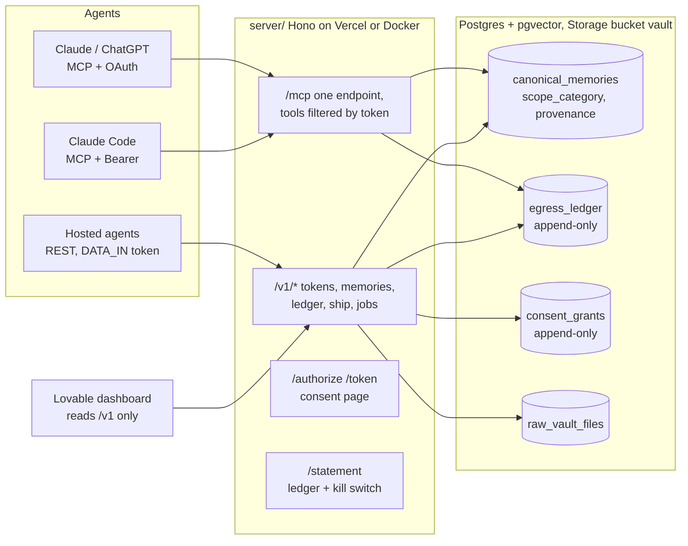

# Data Wallet

**An open-source, self-hostable wallet for your personal data that lives inside your AI agents.**

You deposit exports (a ChatGPT or Claude chat history, your LinkedIn data archive) and the wallet scrubs secrets and
distils them into short facts, each with provenance. Any agent you connect over MCP (Claude, ChatGPT, Claude Code)
reads only the categories you granted, and the filter is a SQL `WHERE` clause, not a prompt. Every read is written to
an append-only statement, you can revoke any agent and the next call fails, and you can ship one category to one
buyer exclusively, after which the wallet refuses resale and deletes its own copy.


Built in one day at Accel AI Innovate London, 15 Oct 2026. Expect rough edges.

> **Honesty note.** The only user is the synthetic "Dana Whitfield". The exports are seeded (`seed/`). The tests are ours
> (`eval/`). LinkedIn and the web are mocked in the demo (`MOCK_LINKEDIN=1`, `MOCK_WEB=1`).

## Architecture



Every owner action is an MCP tool. The REST API under `/v1` is what the tools, the hosted agents and the dashboard call.
The database is the only thing that enforces scope: `scope_category = ANY($scopes) AND is_quarantined = FALSE`.

## Try it in 2 minutes

Against the live demo server. Owner routes need no `Authorization` header today (demo mode, single synthetic owner).

```bash
export U=https://data-wallet-server-five.vercel.app
```

Grant ChatGPT one category and ask a coding question (served) and a money question (blocked):

```bash
CT=$(curl -s -X POST $U/v1/tokens/issue -H 'content-type: application/json' \
  -d '{"consumer_name":"chatgpt","consumer_type":"AI_AGENT_MCP","scopes":["coding_preferences"]}' | jq -r .token)
curl -s -X POST $U/v1/memories/query -H "Authorization: Bearer $CT" -H 'content-type: application/json' \
  -d '{"query":"TypeScript","category":"coding_preferences"}'
curl -s -X POST $U/v1/memories/query -H "Authorization: Bearer $CT" -H 'content-type: application/json' \
  -d '{"query":"mortgage","category":"health_finance_restricted"}'
```

```json
{"records":[{"fact":"Dana prefers TypeScript over Python for backend services.","category":"coding_preferences","provenance":"conv_027#0"}],"served_scopes":["coding_preferences"]}
{"records":[],"notice":"SCOPE_RESTRICTED","blocked_scopes":["health_finance_restricted"],"served_scopes":[]}
```

Read the statement, revoke, and watch the next call fail:

```bash
curl -s "$U/v1/ledger?limit=3"
curl -s -X DELETE $U/v1/tokens/<token_id from the issue response>
curl -s -w ' HTTP %{http_code}\n' -X POST $U/v1/memories/query -H "Authorization: Bearer $CT" \
  -H 'content-type: application/json' -d '{"query":"TypeScript"}'
```

```
{"error":"WALLET_ACCESS_REVOKED","message":"This token has been revoked by the owner"} HTTP 401
```

The full walkthrough, with every response as it came back from the live server, is in
[docs/QUICKSTART.md](docs/QUICKSTART.md): exclusive ship and `RESALE_BLOCKED`, the LinkedIn import job, and
connecting Claude Code to `/mcp` as owner and as a read-only consumer. The rehearsed pitch is in
[docs/DEMO.md](docs/DEMO.md).

## Add it to an agent

| Client | How |
|---|---|
| Claude Code | `claude mcp add --transport http wallet https://<server>/mcp --header "Authorization: Bearer <token>"` |
| claude.ai / ChatGPT | Settings → Connectors → add `https://<server>/mcp`; the wallet's consent page is the scope picker |
| Your own agent | REST under `/v1` with a bearer token from `POST /v1/tokens/issue` |

Owner tokens see 12 tools (deposit, search, connections, revoke, statement, LinkedIn import and drift, offer, ship).
Consumer tokens see two read-only tools: `wallet_get_identity_card` and `wallet_search_memories`.
`GET /mcp/health` lists both sets.

## Run it yourself

All configuration is environment variables; copy `.env.example`. Nothing is tied to the authors' accounts.

| Path | Command | Notes |
|---|---|---|
| **Vercel** | `cd server && vercel` | Root Directory = `server`. Set the env vars, set `PUBLIC_URL` to the deployment URL, redeploy. Database: any Postgres with pgvector (we use Supabase; `supabase db push` applies `supabase/migrations/`). |
| **Docker / self-host** | `OWNER_PASSPHRASE=… docker compose up` | Starts Postgres + pgvector (schema from `db/*.sql`) and the server on :3000. Files go to a local volume. |
| **Plain Node** | `cd server && npm install && npm run dev` | Node 20+, reads `server/.env`, serves http://localhost:3000. `npm test` for unit tests. |

`GET /health` reports database reachability, table count and applied migrations.

## Guarantees

What the code enforces, as opposed to what a policy promises. Each has a test in `eval/`.

| Guarantee | How | Test |
|---|---|---|
| An agent only reads categories you granted | Scope filter is SQL on `canonical_memories`; out-of-scope → empty result + `SCOPE_RESTRICTED` + `SCOPE_BLOCKED` ledger row | `eval/redteam.py` |
| Health and money are never served by default | `health_finance_restricted` only when the token carries it explicitly; the consent page never pre-ticks it | `eval/redteam.py` |
| No secrets in the wallet | Scrubber runs before any fact is written; zero planted secrets may reach the canonical store | `eval/score.py` |
| Every fact is traceable | `source_provenance_ref` is required; no provenance, no row | `eval/score.py` |
| Nothing happens behind your back | `egress_ledger` and `consent_grants` are append-only (DB triggers); every read, block, revoke and ship writes a row | `eval/redteam.py` |
| Revoke takes effect on the next call | Token checks hit Postgres on every request, no cache; revoked → HTTP 401 `WALLET_ACCESS_REVOKED` | `eval/redteam.py` |
| No resale of exclusive data | A new grant on scopes covered by a shipped exclusive grant → HTTP 409 `RESALE_BLOCKED`; the wallet deletes its Storage copy on ship | `eval/redteam.py` |
| Other people's data stays out | LinkedIn connections are stored as a count and top companies only; messages are skipped; exposure scans run only on the owner's verified identifiers | `eval/linkedin_flow.py`, `eval/exposure_flow.py` |

**Promised, not enforced:** that a buyer keeps no copy of data they received. The ledger evidences the contract; it cannot
reach into someone else's systems. Say "the wallet refuses resale and destroys its own copy", never "no copies exist anywhere".

## Dashboard

The owner console (feature 12) is a Lovable app at the repo root (`src/`). It reads `/v1/ledger`, `/v1/connections`
and `/v1/jobs` with the owner token and never holds a service key.


## Repository

```
server/      the wallet server (own Node project; Hono, MCP SDK, pg)     docs/      PRD, quickstart, demo script, media
db/          plain-Postgres schema for Docker                             eval/      red team, score, flow tests (Python)
supabase/    migrations for Supabase                                      seed/      synthetic data generators and outputs
agents/      hosted Normalizer agent (Anthropic Managed Agents)           src/       Lovable dashboard (optional polish)
```

Spec and build rules: [CLAUDE.md](CLAUDE.md). Full vision: [docs/PRD.md](docs/PRD.md).

## Test it

```
python3 seed/generate.py && python3 seed/linkedin.py && python3 seed/exposure.py
python3 eval/redteam.py        # scope, kill switch, resale guard
python3 eval/linkedin_flow.py  # LinkedIn archive job, against the mock
python3 eval/linkedin_drift.py # wallet vs live LinkedIn, against the mock
python3 eval/score.py          # chat-history import quality (Normalizer, in progress)
python3 eval/exposure_flow.py  # find-my-data + GDPR requests (Exposure Finder, in progress)
```

## Licence

Apache-2.0. The web UI at the repo root was started in [Lovable](https://lovable.dev).
