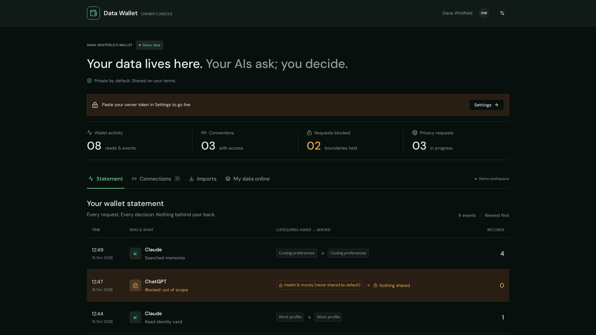

# Demo script (pitch 16:00, 15 Oct 2026)

Six steps, about seven minutes on stage. Rehearse twice. Everything runs against
`https://data-wallet-server.vercel.app` with `MOCK_LINKEDIN=1`. Two chat windows: **Claude** connected with the
owner token, and **ChatGPT** (or a second Claude chat) connected with a `coding_preferences`-only consumer token.

**Say aloud, early:** the user is synthetic ("Dana Whitfield"), the export is seeded, the tests are ours.
**Claim exactly:** "the wallet refuses resale and destroys its own copy", never "no copies exist anywhere".


## Before you walk on (T minus 10 min)

| Check | Command | Expect |
|---|---|---|
| Server up | `curl -s https://data-wallet-server.vercel.app/health` | `"ok":true,"db":"ok"` |
| Both tool sets | `curl -s https://data-wallet-server.vercel.app/mcp/health` | 12 owner tools, 2 consumer tools |
| Claude owner connector | `claude mcp list` or claude.ai Connectors | Connected |
| ChatGPT consumer connector | ask it "what tools do you have from the wallet?" | `wallet_search_memories`, `wallet_get_identity_card` |
| Cron ticking | `curl -s -X POST https://data-wallet-server.vercel.app/v1/jobs/tick` | `{"now":…,"checked":N}` |
| Fresh LinkedIn run possible | run the SQL in `server/INTEGRATION.md` (linkedin lane, note 2) if a previous import exists | job summary shows `deduplicated:false` (cosmetic; `true` is fine too) |
| Dashboard | open the Lovable app, Settings → paste the owner token | Statement tab shows today's rows |

Keep a terminal open with `export U=https://data-wallet-server.vercel.app` and the owner token in `$OT`. That terminal
is the fallback for every step.

## Step 0: LinkedIn into the wallet (0:00, runs while you talk)

**Say:** "First, data in. Dana asks her agent to get her LinkedIn data into the wallet."

**Claude (owner):** *"Get my LinkedIn data into my wallet."*

**Audience sees:** Claude calls `wallet_request_linkedin_export`, shows LinkedIn's real "get a copy of your data" link and
two-line instructions. Say: "the wallet never logs into LinkedIn for you; you click, your own agent watches your inbox
for the 'ready' email. Today the provider is mocked with a two-minute delay, so it runs while we talk."

Mock delay is 120 s by default in the demo; cron ticks every 30 s, so the job is `AVAILABLE` within about 150 s.

**Fallback:** terminal, `curl -s -X POST $U/v1/sources/linkedin/request -H 'content-type: application/json' -d '{"archive_kind":"fast","mock_delay_s":60}'`.

## Step 1: Chat export in, secrets out (0:45)

**Say:** "Second source: her chat history. Exports are full of secrets and other people's names. The wallet scrubs first,
then distils facts, each with a pointer back to the message it came from."

**Claude (owner):** *"Deposit this export into my wallet."* then *"What did it find? Any secrets?"*

**Audience sees:** `wallet_deposit` then `wallet_job_status` or `wallet_search`: a count of facts by category and the
scrubbed-message refs (refs only, never the content). If the hosted Normalizer run from the morning is what's in the
wallet, say so: "this ran earlier; here is what it found."

**Fallback:** the Normalizer is a hosted agent and may be slow live. Skip the deposit and go straight to
*"What do you know about my coding preferences?"* (`wallet_search`), which answers from facts already in the wallet.
Optionally show `eval/RESULTS.md` for the precision and recall numbers and name which model graded them.

## Step 2: A second AI, one category (2:00)

**Say:** "Now the point. ChatGPT gets a key that opens one drawer: coding preferences. Not a prompt that asks nicely. A SQL filter."

**ChatGPT (consumer):** *"What stack should I use for my next backend?"*

**Audience sees:** `wallet_search_memories` returns "Dana prefers TypeScript over Python for backend services." with
provenance `conv_027#0`, and ChatGPT answers from it.

**Fallback:** terminal:
```bash
curl -s -X POST $U/v1/memories/query -H "Authorization: Bearer $CT" -H 'content-type: application/json' -d '{"query":"TypeScript","category":"coding_preferences"}'
```

## Step 3: Same AI, the locked drawer (2:45)

**ChatGPT (consumer):** *"What's my mortgage situation?"*

**Audience sees:** empty result and the `SCOPE_RESTRICTED` notice; ChatGPT says it cannot see health or finance data.

**Say:** "Health and money are never shared unless the owner ticks that box explicitly. And the refusal itself is on the
statement." Switch to the **dashboard** Statement tab or Claude: *"Who read my wallet today?"* Point at the `SCOPE_BLOCKED` row.



**Fallback:** terminal, same query with `"category":"health_finance_restricted"`, then `curl -s "$U/v1/ledger?limit=5"`.

## Step 4: Kill switch (3:45)

**Claude (owner):** *"Who read my wallet today? Revoke ChatGPT."*

**Audience sees:** `wallet_statement` lists the reads and the block; `wallet_revoke` returns `revoked: true`.
Switch to **ChatGPT** and ask anything: the call fails with `WALLET_ACCESS_REVOKED`.

**Say:** "No cache, no grace period. Every token check is a database read, so revoke is instant."

**Fallback:** terminal, `curl -s -X DELETE $U/v1/tokens/<token_id>` then the step-2 query again, expect `HTTP 401`.
The dashboard Connections tab also has a Revoke button if the Lovable session is live.

## Step 5: Ship exclusively, refuse resale (4:45)

**Claude (owner):** *"Ship my shopping data to Acme, exclusive."* then *"Now offer the same to Globex."*

**Audience sees:** `wallet_offer_to_buyer` then `wallet_ship`: `shipped: true`, `exclusive: true`, `shredded_files`.
The second offer returns `RESALE_BLOCKED` with `shipped_to: ["buyer_acme"]`.

**Say:** "The wallet refuses resale and destroys its own copy. It can't reach into Acme's systems; the ledger is the
evidence of the contract."

Note: `buyer_acme` already holds the exclusive `shopping_preferences` grant from the red-team run, so re-offering to Acme
succeeds (same buyer is not resale) and ship reports `already_shipped: true`. Any other buyer name gets the 409.

**Fallback:** terminal, step 5 of [QUICKSTART.md](QUICKSTART.md).

## Step 0, part two: LinkedIn is done, and drift (5:45)

**Claude (owner):** *"Is my LinkedIn import done?"*

**Audience sees:** `wallet_job_status`: `AVAILABLE`, 3 roles, 8 skills, 120 connections counted, top companies, and
`connections_stored_by_name: false`, `messages_skipped: true`.

**Say:** "Connections are other people's data, so we keep a count and the top companies, never names."

**Claude (owner):** *"Is my wallet still up to date with LinkedIn?"*

**Audience sees:** `wallet_linkedin_drift`: promoted to Staff, new acting-manager role, +Rust, −Fastify, +3 connections.
Nothing changed yet; a `LINKEDIN_DRIFT_CHECK` ledger row was written.

**Claude (owner):** *"Apply it."* → `wallet_linkedin_apply_drift`.

**Say:** "Live LinkedIn is mocked today. The real API is EEA-only, and we will not automate LinkedIn's website."

**Fallback:** `curl -s $U/v1/jobs/<job_id>` and `curl -s -X POST $U/v1/sources/linkedin/drift`. If the job is still
`AWAITING_ARCHIVE`, post `$U/v1/jobs/tick` once by hand; if it is `FAILED`, request again with `mock_delay_s: 5` and tick.

## Close (6:45)

"Open source, Apache-2.0, `docker compose up` to self-host, every setting from env. One MCP endpoint, tools depend on
the key you hold. Scope in SQL, ledger append-only, revoke instant, resale refused."

Roadmap slide: OAuth consent for claude.ai and ChatGPT if not shown live, Exposure Finder and GDPR drafts, real LinkedIn
DMA check, buyer webhooks, multi-tenant, KMS.

## If the server is down

`vercel --prod` from `server/` redeploys in about a minute. If that fails, `cd server && npm run dev` with `server/.env`
serves the same database on `http://localhost:3000`; point `$U` and the Claude Code connector there
(`claude mcp add --transport http wallet-owner http://localhost:3000/mcp --header "Authorization: Bearer $OT"`).
The GIF above and the screenshots in `docs/media/` are the last resort: they were captured against the live server today.
