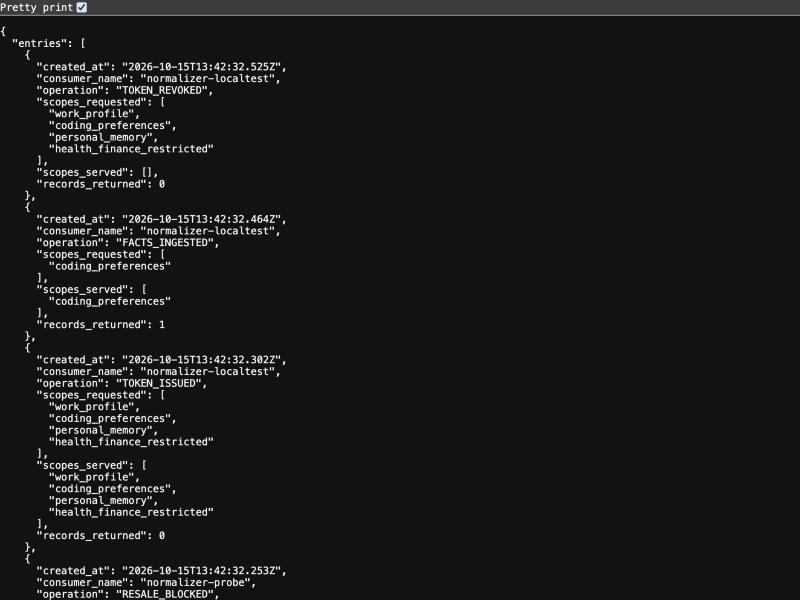
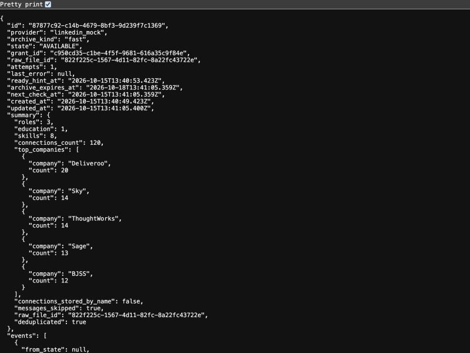

# Quickstart: the wallet from the command line

Every command below was run on 15 Oct 2026 against the live demo server, and every response is pasted as it came
back (tokens replaced by placeholders, nothing else edited). The only user is the synthetic "Dana Whitfield"; the
facts were seeded. Owner routes need no `Authorization` header today (demo mode, single owner); consumer routes need
the consumer's bearer token.

```bash
export U=https://data-wallet-server-five.vercel.app
curl -s $U/health
```
```json
{"ok":true,"db":"ok","tables":14,"migrations":["20261015000001","20261015000002","20261015000003","20261015000004"],"mock":{"linkedin":true,"web":true},"public_url":"https://data-wallet-server-five.vercel.app"}
```

Scopes: `work_profile`, `coding_preferences`, `shopping_preferences`, `personal_memory`, `health_finance_restricted`.
Consumer types: `OWNER`, `DATA_IN_AGENT`, `AI_AGENT_MCP`, `DATA_BUYER_API`.

## 1. Issue tokens

An owner token with all five scopes (the owner may read restricted data because the token carries it explicitly):

```bash
curl -s -X POST $U/v1/tokens/issue -H 'content-type: application/json' -d '{
  "consumer_name": "docs-owner", "consumer_type": "OWNER",
  "scopes": ["work_profile","coding_preferences","shopping_preferences","personal_memory","health_finance_restricted"]}'
```
```json
{"token":"<OWNER_TOKEN>","token_id":"55de5fc8-223b-41cf-8748-fbbcfe8f6e2e","grant_id":"eb8a4e38-27fd-4ff7-a3c3-73d8a66dfa4d","scopes":["work_profile","coding_preferences","shopping_preferences","personal_memory","health_finance_restricted"],"exclusive":false,"expires_at":"2026-11-14T13:40:05.689Z"}
```

A consumer token for ChatGPT with `coding_preferences` only:

```bash
curl -s -X POST $U/v1/tokens/issue -H 'content-type: application/json' -d '{
  "consumer_name": "chatgpt-coding", "consumer_type": "AI_AGENT_MCP", "scopes": ["coding_preferences"]}'
```
```json
{"token":"<CONSUMER_TOKEN>","token_id":"8eab4b96-2dc4-4ceb-afbf-566b42c885d9","grant_id":"b96df141-4c24-4b3e-b28b-b456837eb347","scopes":["coding_preferences"],"exclusive":false,"expires_at":"2026-11-14T13:41:06.322Z"}
```

The plaintext token is returned once; the database stores only its hash.

```bash
export OT=<OWNER_TOKEN> CT=<CONSUMER_TOKEN>
```

## 2. Query memories with each token

The consumer asks about coding and is served:

```bash
curl -s -X POST $U/v1/memories/query -H "Authorization: Bearer $CT" -H 'content-type: application/json' \
  -d '{"query":"TypeScript","category":"coding_preferences","limit":3}'
```
```json
{"records":[{"fact":"Dana prefers TypeScript over Python for backend services.","category":"coding_preferences","provenance":"conv_027#0"}],"served_scopes":["coding_preferences"]}
```

The same consumer asks about money and gets nothing, with a notice. The filter is SQL
(`scope_category = ANY($scopes)`), so there is no model in the loop that could be talked into leaking:

```bash
curl -s -X POST $U/v1/memories/query -H "Authorization: Bearer $CT" -H 'content-type: application/json' \
  -d '{"query":"mortgage","category":"health_finance_restricted","limit":3}'
```
```json
{"records":[],"notice":"SCOPE_RESTRICTED","blocked_scopes":["health_finance_restricted"],"served_scopes":[]}
```

The owner token, which carries the restricted scope, is served:

```bash
curl -s -X POST $U/v1/memories/query -H "Authorization: Bearer $OT" -H 'content-type: application/json' \
  -d '{"query":"mortgage","category":"health_finance_restricted","limit":2}'
```
```json
{"records":[{"fact":"Dana has a mortgage with a fixed rate ending next year.","category":"health_finance_restricted","provenance":"conv_006#2"}],"served_scopes":["health_finance_restricted"]}
```

## 3. Read the statement

Every issue, read and block above is already a ledger row. The ledger is append-only (database trigger).

```bash
curl -s "$U/v1/ledger?limit=3"
```
```json
{"entries":[{"created_at":"2026-10-15T13:41:06.632Z","consumer_name":"chatgpt-coding","operation":"SCOPE_BLOCKED","scopes_requested":["health_finance_restricted"],"scopes_served":[],"records_returned":0},{"created_at":"2026-10-15T13:41:06.507Z","consumer_name":"chatgpt-coding","operation":"MEMORIES_QUERY","scopes_requested":["coding_preferences"],"scopes_served":["coding_preferences"],"records_returned":1},{"created_at":"2026-10-15T13:41:06.327Z","consumer_name":"chatgpt-coding","operation":"TOKEN_ISSUED","scopes_requested":["coding_preferences"],"scopes_served":["coding_preferences"],"records_returned":0}]}
```



## 4. Revoke, and watch the next call fail

```bash
curl -s -X DELETE $U/v1/tokens/8eab4b96-2dc4-4ceb-afbf-566b42c885d9
```
```json
{"revoked":true,"token_id":"8eab4b96-2dc4-4ceb-afbf-566b42c885d9","grant_id":"b96df141-4c24-4b3e-b28b-b456837eb347","consumer_name":"chatgpt-coding"}
```

Token checks hit Postgres on every request, so there is no cache to wait out:

```bash
curl -s -w ' HTTP %{http_code}\n' -X POST $U/v1/memories/query -H "Authorization: Bearer $CT" \
  -H 'content-type: application/json' -d '{"query":"TypeScript"}'
```
```
{"error":"WALLET_ACCESS_REVOKED","message":"This token has been revoked by the owner"} HTTP 401
```

## 5. Ship exclusively, then refuse resale

Offer `shopping_preferences` to one buyer, exclusively. Issuing the grant is the offer; shipping delivers it.

```bash
curl -s -X POST $U/v1/tokens/issue -H 'content-type: application/json' -d '{
  "consumer_name": "buyer_acme", "consumer_type": "DATA_BUYER_API", "scopes": ["shopping_preferences"], "exclusive": true}'
```
```json
{"token":"<BUYER_TOKEN>","token_id":"b88c2d2b-bafe-4b30-b913-8addde8a5504","grant_id":"76dc4e1e-2e2f-4b45-a47d-7b35d5cb644f","scopes":["shopping_preferences"],"exclusive":true,"expires_at":"2026-11-14T13:40:34.690Z"}
```
```bash
curl -s -X POST $U/v1/ship -H 'content-type: application/json' -d '{"grant_id":"76dc4e1e-2e2f-4b45-a47d-7b35d5cb644f"}'
```
```json
{"shipped":true,"grant_id":"76dc4e1e-2e2f-4b45-a47d-7b35d5cb644f","counterparty":"buyer_acme","exclusive":true,"scopes":["shopping_preferences"],"signed_url":null,"shredded_files":0,"already_shipped":false}
```

`shredded_files` counts the raw Storage objects under that grant the wallet deleted (none for the seeded facts, which
have no raw file). A second buyer asking for the same category is refused with HTTP 409, and that refusal is ledgered too:

```bash
curl -s -w ' HTTP %{http_code}\n' -X POST $U/v1/tokens/issue -H 'content-type: application/json' -d '{
  "consumer_name": "buyer_globex", "consumer_type": "DATA_BUYER_API", "scopes": ["shopping_preferences"], "exclusive": true}'
```
```
{"error":"RESALE_BLOCKED","message":"Scopes shopping_preferences were shipped exclusively to buyer_acme; the wallet refuses resale","covered_scopes":["shopping_preferences"],"shipped_to":["buyer_acme"]} HTTP 409
```

## 6. LinkedIn import (mock provider)

The real flow: the wallet gives you LinkedIn's "get a copy of your data" link, you click it (the wallet never automates
LinkedIn), your own agent watches your inbox for the "ready" email, and you deposit the zip. With `MOCK_LINKEDIN=1` the
same state machine runs hands-free and the archive is the seeded `seed/out/linkedin/*.zip`. `mock_delay_s` is how long
the archive takes to become "ready" (the demo uses 120 s; here 3 s).

```bash
curl -s -X POST $U/v1/sources/linkedin/request -H 'content-type: application/json' -d '{"archive_kind":"fast","mock_delay_s":3}'
```
```json
{"job_id":"87877c92-c14b-4679-8bf3-9d239f7c1369","grant_id":"c950cd35-c1be-4f5f-9681-616a35c9f84e","state":"REQUESTED","provider":"linkedin_mock","archive_kind":"fast","deep_link":"https://www.linkedin.com/mypreferences/d/download-my-data","instructions":["1. Open https://www.linkedin.com/mypreferences/d/download-my-data (LinkedIn → Settings & Privacy → Get a copy of your data), choose \"the fast archive (profile, connections, messages…)\" and click Request archive. LinkedIn will ask for your password; the wallet never touches that page.","2. LinkedIn emails you when it is ready (about 10 minutes; the download link lasts ~72 h). Then download the zip and deposit it here, or let your agent watch your inbox and call wallet_archive_ready."],"mock":{"mock_delay_s":3,"mock_outcome":"ok"}}
```

Jobs advance on tick. In production Supabase Cron posts to this route every 30 s; here we call it by hand after the delay:

```bash
curl -s -X POST $U/v1/jobs/tick
```
```json
{"now":"2026-10-15T13:41:05.359Z","checked":1,"transitions":[{"job_id":"87877c92-c14b-4679-8bf3-9d239f7c1369","from":"REQUESTED","to":"AWAITING_ARCHIVE"},{"job_id":"87877c92-c14b-4679-8bf3-9d239f7c1369","from":"AWAITING_ARCHIVE","to":"ARCHIVE_READY"},{"job_id":"87877c92-c14b-4679-8bf3-9d239f7c1369","from":"ARCHIVE_READY","to":"AVAILABLE"}]}
```
```bash
curl -s $U/v1/jobs/87877c92-c14b-4679-8bf3-9d239f7c1369
```
```json
{"id":"87877c92-c14b-4679-8bf3-9d239f7c1369","provider":"linkedin_mock","archive_kind":"fast","state":"AVAILABLE","grant_id":"c950cd35-c1be-4f5f-9681-616a35c9f84e","raw_file_id":"822f225c-1567-4d11-82fc-8a22fc43722e","attempts":1,"last_error":null,"ready_hint_at":"2026-10-15T13:40:53.423Z","archive_expires_at":"2026-10-18T13:41:05.359Z","next_check_at":"2026-10-15T13:41:05.359Z","created_at":"2026-10-15T13:40:49.423Z","updated_at":"2026-10-15T13:41:05.400Z","summary":{"roles":3,"education":1,"skills":8,"connections_count":120,"top_companies":[{"company":"Deliveroo","count":20},{"company":"Sky","count":14},{"company":"ThoughtWorks","count":14},{"company":"Sage","count":13},{"company":"BJSS","count":12}],"connections_stored_by_name":false,"messages_skipped":true,"raw_file_id":"822f225c-1567-4d11-82fc-8a22fc43722e","deduplicated":true},"events":[{"from_state":null,"to_state":"REQUESTED","note":"mock provider, delay 3s, outcome ok","created_at":"2026-10-15T13:40:49.423Z"},{"from_state":"REQUESTED","to_state":"AWAITING_ARCHIVE","note":"mock: owner clicked \"Request archive\"","created_at":"2026-10-15T13:41:05.400Z"},{"from_state":"AWAITING_ARCHIVE","to_state":"ARCHIVE_READY","note":"mock: \"your data is ready\" email seen by the owner agent","created_at":"2026-10-15T13:41:05.400Z"},{"from_state":"ARCHIVE_READY","to_state":"INGESTING","note":"mock: archive downloaded (Basic_LinkedInDataExport_10-15-2026.zip, 3834 bytes), attempt 1","created_at":"2026-10-15T13:41:05.400Z"},{"from_state":"INGESTING","to_state":"AVAILABLE","note":"ingest complete","created_at":"2026-10-15T13:41:05.400Z"}]}
```

Note `connections_count: 120` with `connections_stored_by_name: false` and `messages_skipped: true`: other people's
data never enters the wallet. `deduplicated: true` means the archive's sha256 matched an earlier deposit.



## 7. Connect Claude Code over MCP

One endpoint; the tool list depends on the token. Add the wallet twice to see the difference:

```bash
claude mcp add --transport http wallet-owner https://data-wallet-server-five.vercel.app/mcp --header "Authorization: Bearer <OWNER_TOKEN>"
claude mcp add --transport http wallet-coding https://data-wallet-server-five.vercel.app/mcp --header "Authorization: Bearer <CONSUMER_TOKEN>"
claude mcp list
```
```
Added HTTP MCP server wallet-owner with URL: https://data-wallet-server-five.vercel.app/mcp to local config
Added HTTP MCP server wallet-coding with URL: https://data-wallet-server-five.vercel.app/mcp to local config
wallet-owner: https://data-wallet-server-five.vercel.app/mcp (HTTP) - ✔ Connected
wallet-coding: https://data-wallet-server-five.vercel.app/mcp (HTTP) - ✔ Connected
```

What each one sees (`tools/list` over the same endpoint with each token):

| Token | Tools |
|---|---|
| owner | `wallet_search`, `wallet_connections`, `wallet_revoke`, `wallet_statement`, `wallet_job_status`, `wallet_request_linkedin_export`, `wallet_archive_ready`, `wallet_deposit`, `wallet_linkedin_drift`, `wallet_linkedin_apply_drift`, `wallet_offer_to_buyer`, `wallet_ship` |
| consumer (read-only, `readOnlyHint: true`) | `wallet_get_identity_card`, `wallet_search_memories` |

`GET /mcp/health` lists both sets without a token:

```bash
curl -s $U/mcp/health
```
```json
{"ok":true,"tools_owner":["wallet_request_linkedin_export","wallet_archive_ready","wallet_linkedin_drift","wallet_linkedin_apply_drift","wallet_deposit","wallet_job_status","wallet_search","wallet_connections","wallet_revoke","wallet_statement","wallet_offer_to_buyer","wallet_ship"],"tools_consumer":["wallet_get_identity_card","wallet_search_memories"]}
```

In Claude Code, "What stack should I use?" through `wallet-coding` is answered from `wallet_search_memories`;
"What's my mortgage situation?" returns the `SCOPE_RESTRICTED` notice and writes a `SCOPE_BLOCKED` row.
Revoke the token (`DELETE /v1/tokens/{id}` or `wallet_revoke` from the owner side) and the connection's next call is
HTTP 401 `WALLET_ACCESS_REVOKED`.

For claude.ai and ChatGPT the same endpoint is added as a custom connector; the wallet's own OAuth consent page is the
scope picker and never pre-ticks `health_finance_restricted`.

## Still in progress today

The chat-history Normalizer (hosted agent posting to `POST /v1/facts`, see [../agents/README.md](../agents/README.md))
and the Exposure Finder (`/v1/exposure`, `/v1/privacy-requests`) are being finished in other lanes. Their routes exist
on the server but are not documented here until their tests are green.
